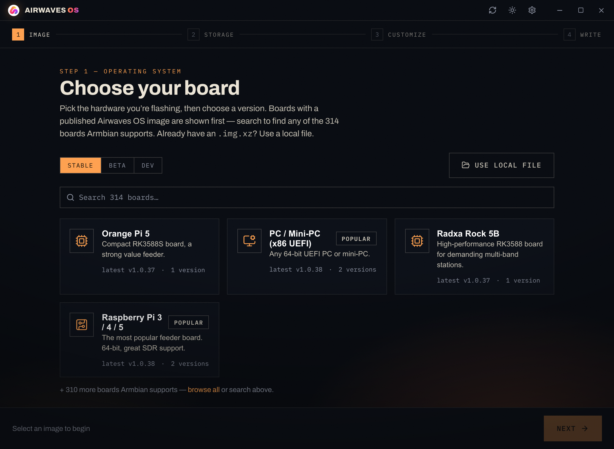
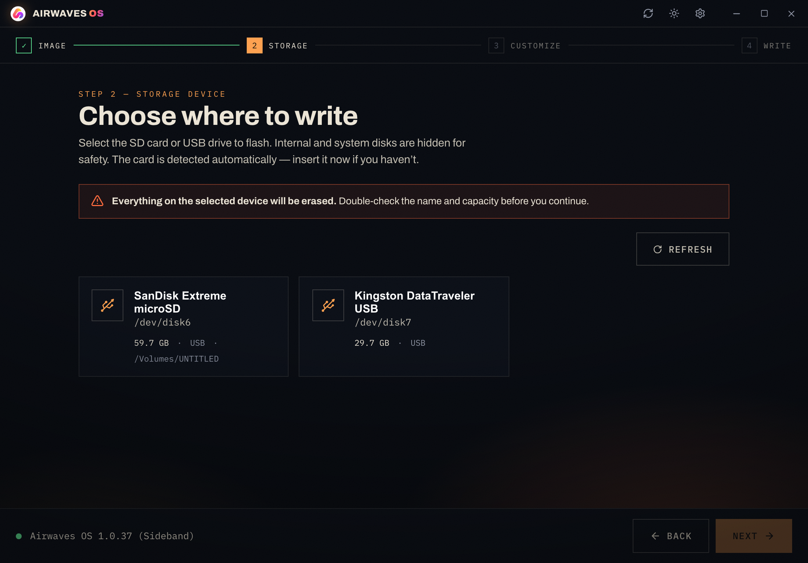
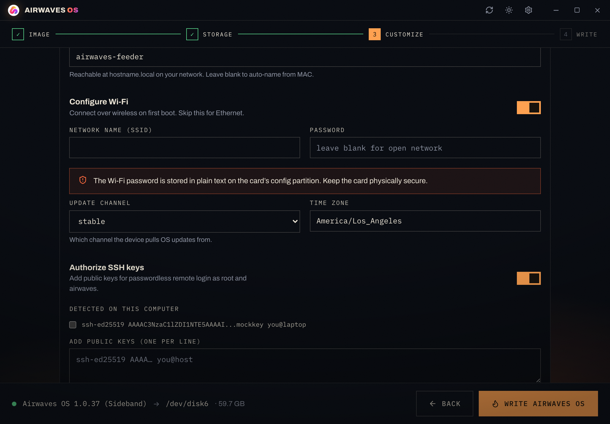
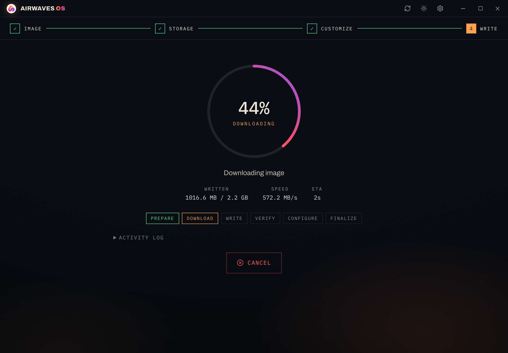
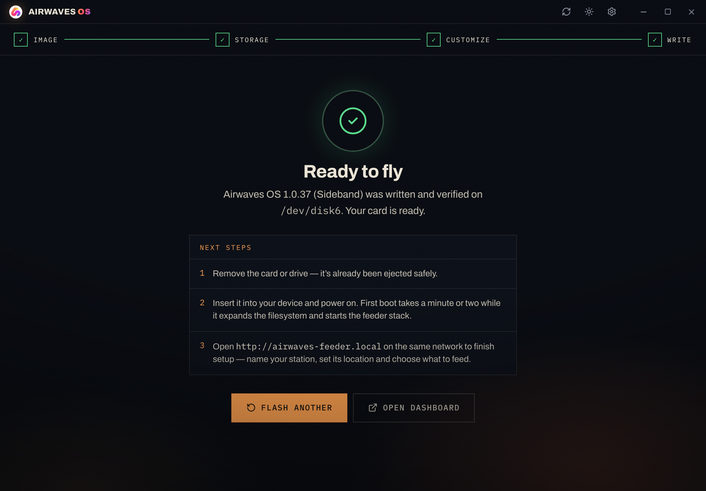

# Airwaves OS Flasher

An attractive, cross-platform desktop app that writes **Airwaves OS** — the
[Airframes](https://airframes.io) aviation-data feeder OS — to SD cards and USB
drives, and pre-configures a device for headless first boot. Built with
**Tauri 2 + Rust + React**. Original code, architecturally inspired by
rpi-imager / balenaEtcher / caligula.

> Choose an image → choose a drive → (optionally) customize → write → verify → done.



| Storage | Customize | Writing | Done |
|---|---|---|---|
|  |  |  |  |

The visual design mirrors the airwavesos.com "night-watch" aesthetic — ink-dark
navy, an amber beacon accent, Archivo + IBM Plex Mono, film grain and vignette.
Dark and light themes both ship.

---

## What it does

- **Image catalog** — fetches a published `catalog.json` over HTTPS (configurable
  URL) listing every board image per channel (stable / beta / dev), with sizes,
  checksums and release notes. If the catalog is unreachable it **falls back to
  the GitHub Releases API** for `airframesio/airwaves-os`, synthesizing entries
  from `Airwaves_OS_<board>-<ver>.img.xz` assets. You can always pick a **local
  file** instead.
- **Every Armbian board** — the board picker lists all ~314 platforms Armbian
  supports (generated from `armbian-build` via `scripts/gen-catalog.mjs`). Boards
  with a published Airwaves OS image are shown first; the rest are searchable and
  can be flashed from a local file. Pick a board, then a **version** from a
  dropdown that defaults to the channel's latest.
- **Safe drive selection** — lists removable drives only; system/internal disks
  are hidden and the elevated writer re-validates the target independently.
- **Streaming write** — downloads (or opens) the image, decompresses
  `.xz` / `.gz` / `.zst` / `.zip` **on the fly** (never staging a decompressed
  copy), writes the raw device, flushes, then **reads back and verifies** by
  SHA-256.
- **First-boot customization** — writes `airwaves-install.json` directly into the
  FAT32 **AWCFG** partition on the card (no OS mount needed), pre-seeding
  hostname, Wi-Fi, time zone, update channel and SSH keys — exactly the fields
  the OS's `airwaves-preconfig` service applies on first boot. Station identity
  (operator, location, feeds) is configured afterwards in the device's web
  dashboard, by design.

---

## Architecture

A thin **unprivileged GUI** plus a small **elevated one-shot helper** — only the
device-touching code ever runs as root/admin, which keeps the auto-updater and
the rest of the app unprivileged.

```
airwaves-flasher (Tauri, unprivileged)
  React UI ⇄ Rust commands (fetch_catalog, list_drives, inspect_image,
                            detect_ssh_keys, start_flash, cancel_flash)
        │ spawns elevated, tails NDJSON → flash://progress events
        ▼
awflash-helper (elevated CLI)
  assert-safe-target → unmount → write → flush → read-back verify
                     → write AWCFG config → eject
```

| Crate | Role |
|---|---|
| `crates/awflash-core` | catalog, enumeration, image inspection, decompress, raw device I/O, verify, FAT customize, escalation |
| `crates/awflash-helper` | the elevated writer; streams `FlashProgress` NDJSON to a file the GUI tails |
| `src-tauri` | the unprivileged Tauri app: commands + flash orchestrator + window chrome |
| `src/` | React 19 + Zustand wizard (runs against a mock in a plain browser) |

Escalation is OS-native: macOS `osascript … with administrator privileges`
(Touch ID), Linux `pkexec` → `sudo` → `doas`, Windows `Start-Process -Verb RunAs`
(UAC). See `docs/RESEARCH-PLAN.md` for the full design and rationale.

---

## Develop

Prerequisites: Node 20+, pnpm, Rust 1.77+, and the Tauri 2 system deps for your
OS (https://tauri.app/start/prerequisites).

```bash
pnpm install

# UI only, in a browser, against the mock backend (fast design loop):
pnpm dev          # → http://localhost:1420

# Full desktop app (real Rust backend). Build the elevated helper once so the
# app can find it next to its own binary:
cargo build -p awflash-helper
pnpm tauri dev
```

`pnpm tauri build` produces installers per OS (see `docs/RESEARCH-PLAN.md §8`
for signing/notarization, the helper sidecar, and auto-update wiring, which
belong in CI).

The app icons were generated from the official `airwaves.png` with
`pnpm tauri icon`.

---

## The catalog

The flasher consumes an original, flat schema (see `src/types.ts` and
`docs/catalog.example.json`). Default URL:

```
https://raw.githubusercontent.com/airframesio/airwaves-os/main/flasher/catalog.json
```

Publish that file (or change the URL in Settings) and the flasher shows a rich,
filterable catalog. Until it exists, the GitHub Releases fallback keeps the app
working from the existing `.img.xz` release assets.

`downloadSha256` verifies the compressed download (fail fast); `sha256` is the
read-back target for the written, decompressed image.

**Board + version coverage.** The full device list and the current image set are
generated from the Armbian board configs:

```bash
node scripts/gen-catalog.mjs            # → src/data/armbianBoards.ts + docs/catalog.example.json
```

Re-run it when Armbian adds boards or Airwaves ships new images. Version
filtering is channel-aware: legacy Armbian-era date versions (`23.11.*`, `24.*`)
are always hidden, stable/beta require `>= 1.0.37`, and dev shows the current
1.x builds (e.g. the latest dev line at 1.0.24).

---

## Status / verification

- **Frontend** — complete and verified end-to-end in the browser (both themes),
  every wizard screen.
- **Rust backend** — the read-only commands (catalog + GitHub fallback, drive
  enumeration, image inspection incl. xz uncompressed-size parsing, SSH-key
  detection) and the full write/verify/customize pipeline are implemented and
  compile cleanly. The macOS write path uses `/dev/rdiskN` + `F_NOCACHE`; Linux
  uses `O_EXCL`; Windows uses `FILE_FLAG_WRITE_THROUGH`. **The destructive device
  write should be validated against real hardware on each OS before release**
  (the helper supports a regular-file dry-run target for safe pipeline testing).
  See `docs/RESEARCH-PLAN.md §9` (Phases 2–4).

## License

MIT © Airframes
# airwaves-flasher
